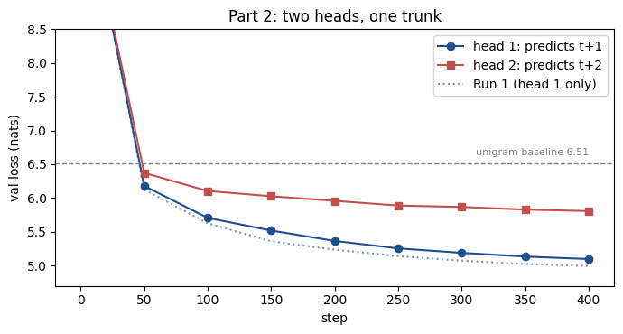
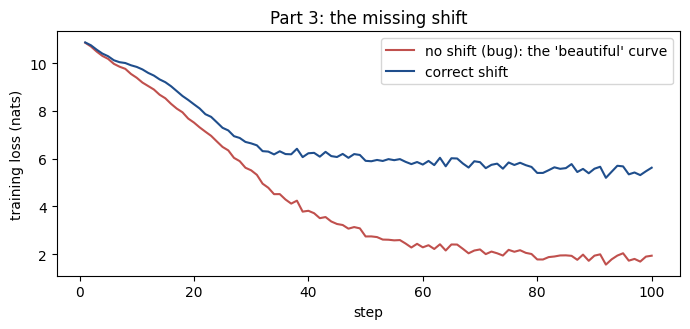

# ERA V5 · Session 9: a loss harness, checked piece by piece

[](https://colab.research.google.com/github/Pritish52718/era-v5-loss-harness/blob/main/loss_harness.ipynb)

This project trains a small GPT on Tiny Shakespeare and uses it to check, one piece at a time, the next-token loss and everything around it:

- the shift between inputs and targets
- the padding and packing masks
- the perplexity of an untrained model
- weight tying
- the peak memory of the output head

Part 2 adds a second head that predicts token *t+2*. Part 3 makes the missing-shift bug on purpose.

Every number below comes from **one top-to-bottom run** of [loss_harness.ipynb](loss_harness.ipynb) on a Colab T4 GPU, which takes about 5 minutes.

## Setup

| | |
|---|---|
| data | Tiny Shakespeare in GPT-2 tokens (vocabulary V = 50,257): 338,025 tokens. The first 90% (304,222) is train and the last 10% (33,803) is val. |
| model | decoder-only GPT: 6 layers, width D = 256, 4 attention heads, SwiGLU feed-forward (704), RMSNorm, learned positions, context 128. **30.6M parameters** with an untied head. |
| training | 400 steps of 16 × 128 tokens, about 2.7 passes over the train set. AdamW (lr 1e-3, warmup then cosine decay), dropout 0.1. |
| val loss | the mean over the **same 10 fixed batches** every time (20,320 targets) |

## Results

### Part 1: seven checks

| # | check | result |
|---|---|---|
| 1 | tensor shapes | logits `[4, 128, 50257]`, shifted and flattened to `[508, 50257]`, against targets `[508]` |
| 2 | shift, printed as strings | target at *t* = input at *t+1* for all **126** pairs checked |
| 3 | padding mask | contributing targets **120 → 86**; loss 8.2686 → **4.5091** |
| 4 | two packed documents | loss **5.5872 → 5.5216** with the boundary masked (89 → 88 targets) |
| 5 | untrained perplexity | **52,743** vs V = 50,257 |
| 6 | tied vs untied head | **17,718,784** vs **30,584,576** parameters |
| 7 | peak memory, ordinary vs chunked cross-entropy | **2,358 MiB** vs **104 MiB**, i.e. **22.6×** less (4,096 tokens) |

### Part 2: a second head predicting *t+2* (val loss at step 400)

| L1 (head 1, *t+1*) | L2 (head 2, *t+2*) | L1 + L2 | Run 1, one head (*t+1*) |
|---|---|---|---|
| **5.0964** | **5.8066** | **10.9031** | 4.9924 |

### Part 3: the missing shift

| | loss |
|---|---|
| training loss after 100 steps, **with the bug** | **1.934** |
| training loss after 100 steps, correct | 5.621 |
| the buggy model, scored with the correct harness | **9.490** |

---

## Part 1 in detail

### 1–2. Shapes and the shift

The notebook prints all 16 activation shapes and every parameter tensor, with a one-line meaning for each dimension.

Each 128-token row gives 127 predictions, because the last position has nothing after it: 4 rows × 127 = 508. Printed as strings, the targets are the inputs moved one place to the left:

```
inputs : 'O:\nBe collected:\nNo more amazement: tell your'
targets: ':\nBe collected:\nNo more amazement: tell your p'
```

### 3. Padding

Four speeches of 12, 18, 31 and 29 tokens are padded to 31. That gives 4 × 30 = 120 targets, 34 of which are pads. Masking with `ignore_index = -100` leaves 86.

| version | loss |
|---|---|
| pads counted | 8.2686 |
| pads masked | **4.5091**, the same as running each speech alone |
| masked, but divided by 120 instead of 86 | 3.2315 = 4.5091 × 86 / 120 |

Pads are unpredictable: they average 17.78 nats each, so counting them inflates the loss. The last row is a quieter bug: the mask is right but the denominator is wrong, so the loss **looks better than it really is**.

### 4. Packing two documents

Speech A (53 tokens, ending "…and Dian sportful!") is followed by speech B (37 tokens, starting "ALONSO:"). The boundary pair, '!' → 'AL', asks the model to predict the start of B from the end of A. It costs **11.358 nats**, against 5.522 on average for the other pairs.

| version | loss | targets |
|---|---|---|
| no mask | 5.5872 | 89 |
| boundary loss masked | 5.5216 | 88 |
| + document-aware attention (B cannot see A, positions restart) | 5.4079 | 88 |
| A and B run separately | 5.4079 | 88 |

Masking the loss removes the one bad target, but **the leak remains**: B's tokens can still attend to A. On B's own tokens the loss is 5.5305 when B sees A, and 5.2526 when it doesn't. Only document-aware attention matches the separate runs, to within 1.4 × 10⁻⁶ per token (float32 rounding).

*Limit:* this is one pair of documents. How much B is hurt depends on how unrelated A is.

### 5. Untrained perplexity

A model that knows nothing spreads its probability evenly, so its loss should be ln V = 10.8249 and its perplexity (e^loss) should be V. The measured loss is **10.8732**, giving a perplexity of 52,743, which is 1.049 × V.

It isn't exactly V because the initial logits aren't all equal: their spread is σ = 0.320 (≈ 0.02 × √256). For random logits, the loss ≈ ln V + σ²/2 = 10.8761, within 0.003 of the measurement.

*Limit:* this confirms that the initialisation scale is sane. It says nothing about whether the shift is correct.

### 6. Tied vs untied head

Tying saves V × D = 50,257 × 256 = 12,865,792 parameters, which is 42.1% of the untied model. All 6 transformer blocks together have only 4,819,968, so the output head alone is 2.7× as large as all of them.

*Limit:* this share is huge only because the model is so narrow. In wider models the blocks grow faster than the head.

### 7. Peak memory: ordinary vs chunked cross-entropy

The chunked loss is a custom `torch.autograd.Function`:
- the **forward pass** keeps only one log-sum-exp number per row
- the **backward pass** recomputes each 256-row chunk's logits, rather than storing them all

Each variant runs in a fresh process and is measured with `torch.cuda.max_memory_allocated`.

| tokens N | logits if stored | ordinary | chunked | ratio |
|---|---|---|---|---|
| 1,024 | 196 MiB | 589 MiB | 101 MiB | 5.8× |
| 2,048 | 393 MiB | 1,178 MiB | 102 MiB | 11.5× |
| 4,096 | 785 MiB | **2,358 MiB** | **104 MiB** | **22.6×** |
| 4,096, forward-only chunking | | 904 MiB | | |

- **Ordinary** peaks at about **3 copies** of the logits (2,358 ≈ 3 × 785).
- **Chunked** stays nearly flat. It's mostly the gradient for W (49 MiB) plus one chunk of logits (49 MiB).
- **Chunking only the forward pass** still reaches 904 MiB, because autograd keeps every chunk for the backward pass. The saving comes from *recomputing*, not from slicing.
- **Correctness:** in this run the loss is identical (5.0778432 in both). The gradients agree to a relative 5.0 × 10⁻⁷ (hidden states) and 1.4 × 10⁻⁶ (W). They aren't bit-identical, because float32 sums added in a different order round differently.

*Limits:*
- **The ratio is not a constant.** It grows with N. At our training batch size (2,048 tokens) it is 11.5×, not 22.6×.
- **This measures the loss only.** The memory for activations, weights and optimizer state is unchanged.
- **Chunked is 3.2× slower** (0.38 s vs 0.12 s), because of the recomputation and a Python loop over the chunks.

---

## Part 2: a second head for *t+2*

The same trunk now feeds two `[V, D]` heads. At position *t*, head 1 predicts *t+1* and head 2 predicts *t+2*. Training minimises **L1 + L2**, with equal weight.

The comparison with Run 1 is controlled:
- the trunk and head 1 start from **identical weights**, as checked in the notebook
- training sees the same batches in the same order

Dropout masks may still differ between the runs.

| step | 50 | 100 | 150 | 200 | 250 | 300 | 350 | 400 |
|---|---|---|---|---|---|---|---|---|
| Run 1 | 6.125 | 5.625 | 5.358 | 5.235 | 5.139 | 5.072 | 5.023 | 4.992 |
| L1, *t+1* | 6.178 | 5.706 | 5.518 | 5.364 | 5.254 | 5.188 | 5.132 | 5.096 |
| L2, *t+2* | 6.371 | 6.104 | 6.026 | 5.958 | 5.888 | 5.867 | 5.829 | 5.807 |
| gap L2 − L1 | 0.193 | 0.398 | 0.508 | 0.594 | 0.635 | 0.679 | 0.696 | 0.710 |



**How the second head behaves over training:**

- **t+2 is harder at every step after the start.** Doubt piles up: to guess two tokens ahead, the head must also cover every possibility for the token in between.
- **The gap widens from 0.19 to 0.71.** Early on, both heads learn the same easy thing, which tokens are common, and that doesn't depend on how far ahead you look. Later the model learns to use the context, and the context says much more about the *next* token than the one after. From step 100 to 400, head 1 improved by 0.61 and head 2 by only 0.30.
- **Head 2 does use the context.** It beats a frequency-only (unigram) baseline of **6.510** from step 50 onwards. At the end, it typically gives the right token about 1/330 of its probability, against 1/672 for the baseline.
- **The extra head cost head 1 a little.** Head 1 ends **0.104** worse than Run 1 (perplexity 147 → 163). One likely reason is that the 256-wide trunk now serves two jobs. The cost peaked at 0.16 around step 150 and had shrunk to 0.10 by step 400.

*Limits:*
- **One run per setting.** An earlier run with a different initialisation, not kept in this notebook, ended head 1 at 5.042. That's also worse than Run 1, so the direction looks real, but the size is uncertain by about ±0.05.
- **Neither reason multi-token prediction is used at scale is tested here.** One is a denser training signal for *large* models; the other is draft tokens for speculative decoding. This is a 30M model trained for 400 steps.

---

## Part 3: the missing shift

The brief's deliverables mention a "Part 3 demonstration" but don't define a Part 3. I took it to mean the bug the brief warns about: *"A target shift in the incorrect direction can produce a beautiful loss curve. Print the strings."*

The bug is one line, with no offset between logits and targets:

```python
F.cross_entropy(logits.reshape(-1, V), tokens.reshape(-1))   # position t is asked for token t
```

Attention lets position *t* see token *t* itself. So the "answer" is in the model's input, and it only has to copy it through.



| | loss | right next token gets about |
|---|---|---|
| bug, its own training loss at step 100 | **1.934** | (it's graded on copying) |
| correct run, training loss at step 100 | 5.621 | |
| bug, scored with the **correct** harness | **9.490** | 1 in 13,200 |
| correct run, val loss at step 100 | 5.625 | 1 in 277 |
| frequency-only baseline | 6.510 | 1 in 672 |
| untrained model | 10.873 | 1 in 52,700 |

The buggy curve beats the correct one by 3.7 nats. Yet asked for the *next* token, the buggy model is worse than simply counting words, and puts about **48× less** probability on the right token than the correct model after the same 100 steps.

**The training loss alone cannot reveal this bug.** Two cheap checks catch it:
- **Print the strings.** With the bug, every input equals its target ('O' → 'O', ' collected' → ' collected').
- **Distrust a loss that's too good.** 1.9 nats after 100 steps, when the correct model reaches only about 4.5 after 400, is not believable.

*Limit:* this is only 100 steps of buggy training. With more steps the copying would strengthen, and its effect on the real score wasn't measured.

---

## Reproduce

Open the notebook in Colab, choose a T4 GPU runtime, and run all cells (about 5 minutes). The notebook downloads Tiny Shakespeare from Karpathy's `char-rnn` repository.

Training results can vary by about 0.001 between GPU runs, because the GPU doesn't always add numbers in the same order.

| file | what it is |
|---|---|
| [loss_harness.ipynb](loss_harness.ipynb) | the notebook, with the outputs of the run quoted above |
| [figures/](figures/) | Run 1's loss curve, and the Part 2 and Part 3 plots |
